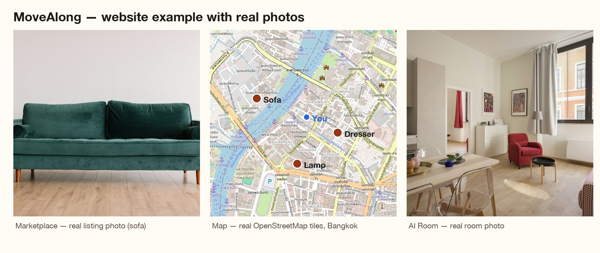
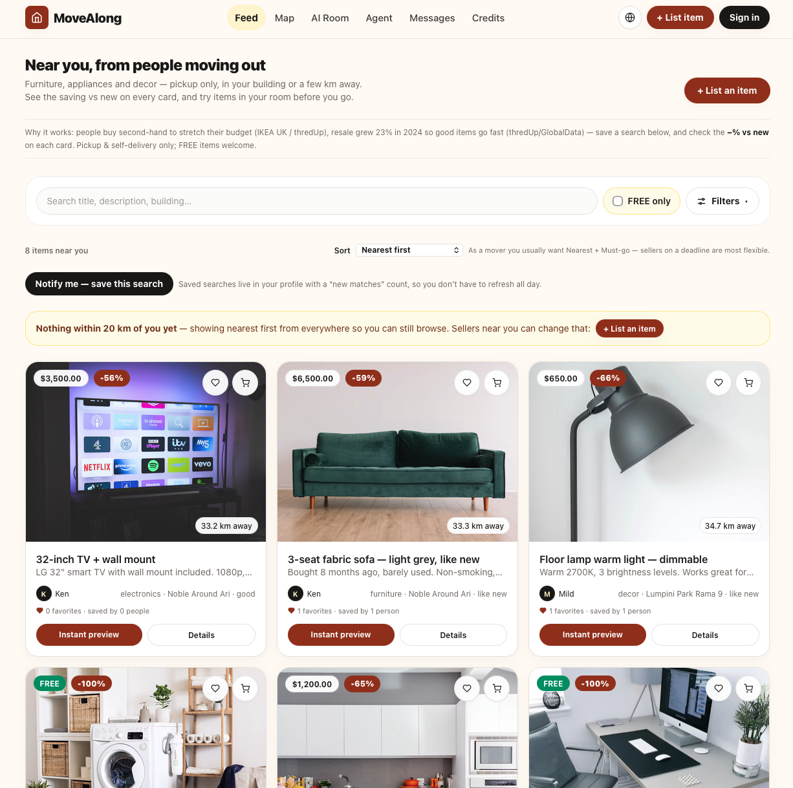
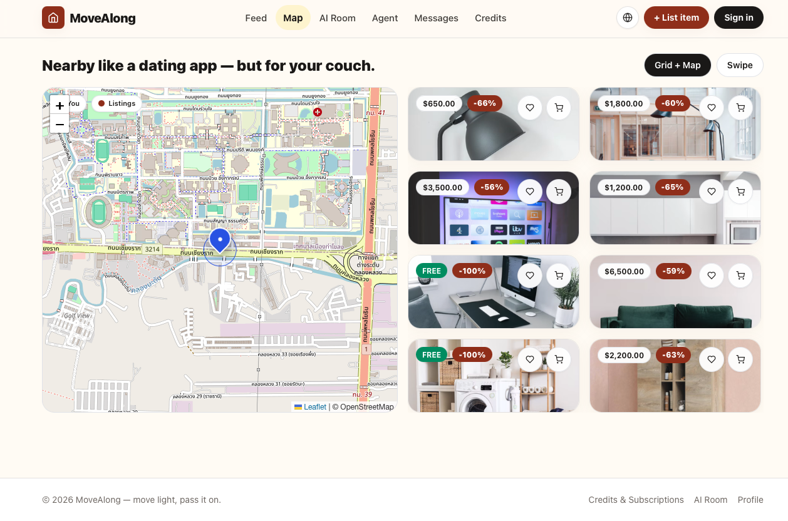
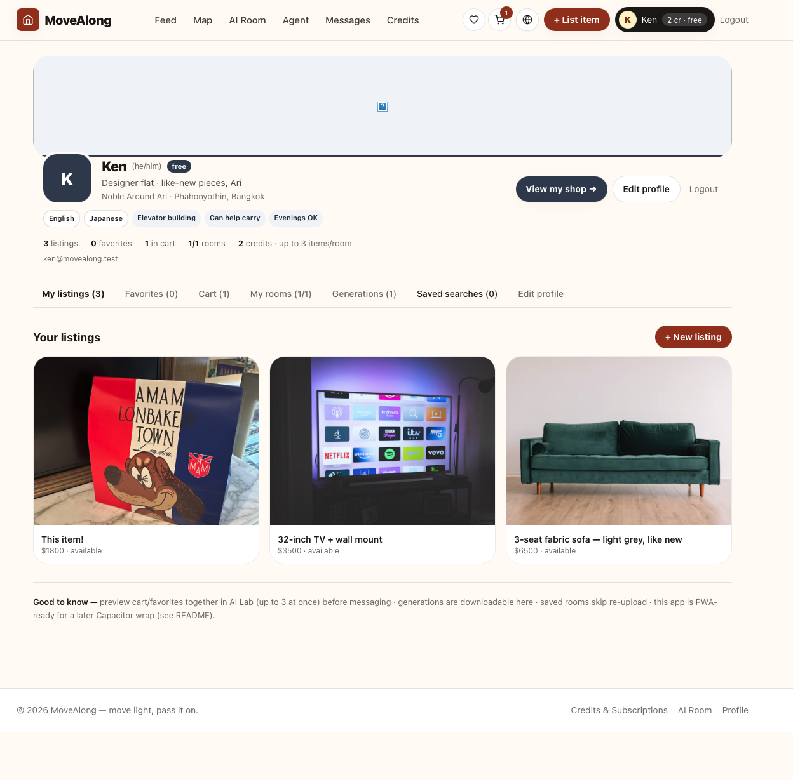

# MoveAlong — Second-hand marketplace for movers

> **Move light, pass it on.** A Tinder-like map marketplace for people moving out of apartments, condos, and houses. Sell, buy, or give away what you can't carry — discovered by building and distance, tried in your room with AI before you go pick it up.

      

**Live stack (works today):** `http://localhost:3000` after one of the run methods below.
**Mobile path:** same Next.js codebase → wrap with Capacitor (iOS/Android) or migrate shared components to Expo — documented in § Mobile.
**Theme:** Warm home tones (terracotta / stone) — credible like a real apartment, fast, no purple gradients.

## Website example



*Built from real photos used by the app: a real listing photo (sofa), real OpenStreetMap tiles of Bangkok with item pins, and a real room photo. Not a browser screenshot — run the app to see the live UI.*

**Demo video:** [MoveAlong — 3-minute narrated demo (MP4)](docs/movealong-demo-3min.mp4) — the problem, feed, map/swipe, selling, AI room preview, Baan concierge, trust/handover, and how to run it. (Narrated slideshow using the same real listing/room photos and real OpenStreetMap tiles — not a screen recording.)

### Real app captures

| Feed | Map | Profile |
|---|---|---|
|  |  |  |

Screen recordings from the real app: [AI Room recording](docs/images/AI%20Room.mov) · [Agent (Baan) recording](docs/images/Agent.mov)

Pages shown in the example:

- **Marketplace feed** — search, FREE items, furniture cards, prices, distance, and pickup details.
- **Map view** — nearby second-hand items around the user's pickup area.
- **AI Room Preview** — selected second-hand furniture placed into the user's room before pickup.

---

## Table of contents

1. [What it does](#what-it-does)
2. [Demo accounts & seeded data](#demo-accounts--seeded-data)
3. [Docker fix — Prisma OpenSSL](#docker-fix--prisma-openssl)
4. [Tech choices — why web-first, mobile-ready](#tech-choices--why-web-first-mobile-ready)
5. [Architecture](#architecture)
6. [Project structure](#project-structure)
7. [Run it yourself — 2 ways](#run-it-yourself--2-ways)
8. [ENV file](#env-file)
9. [Features in detail](#features-in-detail)
10. [Favorites & Cart — choose in AI Lab](#favorites--cart--choose-in-ai-lab)
11. [AI "Try items in your room" — Meta Muse Image (publishable)](#ai-try-items-in-your-room--meta-muse-image-publishable)
12. [Saved rooms & Generations in profile](#saved-rooms--generations-in-profile)
13. [Profile edit](#profile-edit)
14. [Map — dating-app discovery](#map--dating-app-discovery)
15. [API reference](#api-reference)
16. [What you might have overlooked — what I added](#what-you-might-have-overlooked--what-i-added)
17. [Going to mobile (Android / iOS)](#going-to-mobile-android--ios)
18. [Production checklist](#production-checklist)
19. [Scripts](#scripts)
20. [Troubleshooting](#troubleshooting)

---

## What it does

| User flow | What happens |
|---|---|
| **Moving out** | Create a listing with 1–8 photos (different angles), optional W×H×D + unit, category, condition, price or FREE, building/address, pickup mode. Your browser geolocation is stored so the item shows on the map. |
| **Discovering** | Feed with search, category pills, FREE-only toggle, building filter, distance slider (1–50 km). Same feed is also a **Map** (Leaflet + OpenStreetMap, no API key) and a **Swipe** stack like a dating app. |
| **Shortlisting** | Heart = Favorite, Cart icon = Cart (pickup planning shortlist). Both appear in the header with counts and feed straight into AI Lab. From any card or detail page, **Instant preview** jumps you into AI Lab with that item pre-selected. |
| **Trying before fetching** | Save your room once (or upload each time), then place **multiple items together** (3 free / 5 Plus / 8 Pro). With a Meta Model API key you get photoreal Muse Image output you can publish immediately; without a key we composite instantly on-device. |
| **Handover** | Pickup/self-delivery only — no shipping. Buyer contacts seller (email/CTA) and meets at lobby/public area. |

Supported categories: `furniture`, `appliance`, `decor`, `kitchen`, `electronics`, `other`. Conditions: `new`, `like_new`, `good`, `fair`, `poor`. Delivery: `pickup`, `self_delivery`, `both`.

---

## Demo accounts & seeded data

Run `npm run db:seed` (or `docker compose up` auto-seeds). You get:

| Email | Password | Building | Credits | Tier |
|---|---|---|---|---|
| `demo@movealong.test` | `123456` | Ideo Sukhumvit 93 | **12** | free (test-rich) |
| `mild@movealong.test` | `123456` | Lumpini Park Rama 9 | 3 | free |
| `ken@movealong.test` | `123456` | Noble Around Ari | 8 | plus |

**Demo user is pre-loaded for testing:** 1 saved room ("My living room — Ideo"), 2 favorites (sofa, lamp), 2 cart items (lamp, TV), 2 generations (multi-item scenes). Login and open `/profile` → tabs, or `/ai-lab` → see the pre-selected room + items.

Seeded listings (8): IKEA MALM dresser, free washing machine, 3-seat sofa, free standing desk + chair, kitchen lot, TV + mount, wooden coffee table, floor lamp — all with building, coords, dimensions, and **real product/room photos from Unsplash** (demo data — not real sellers).

---

## Docker fix — Prisma OpenSSL

**Your log:**
```
prisma:warn Prisma failed to detect libssl/openssl version... Defaulting to "openssl-1.1.x"
Error loading shared library libssl.so.1.1: No such file (needed by libquery_engine-linux-musl-arm64-openssl-1.1.x.so.node)
```

**Root cause:** The old image was `node:20-alpine` (musl). At `prisma generate` time OpenSSL wasn't installed, so Prisma guessed `openssl-1.1.x` and baked an engine linking `libssl.so.1.1`. Alpine Bookworm ships OpenSSL 3 (`libssl.so.3`), so the engine failed to load at runtime.

**Fix applied:**
- Base image changed to `node:20-bookworm-slim` (Debian, glibc, ships OpenSSL 3).
- `apt-get install openssl ca-certificates libssl-dev` runs **before** `npm install` / `prisma generate`.
- `prisma/schema.prisma` now declares `binaryTargets = ["native", "debian-openssl-3.0.x", "linux-musl-openssl-3.0.x"]`.
- CMD uses `npx tsx prisma/seed.ts` (previously `node prisma/seed.js` would fail — seed is TypeScript).

Rebuild: `docker compose down -v && docker compose up --build` — the warning disappears and the engine loads `debian-openssl-3.0.x`.

---

## Tech choices — why web-first, mobile-ready

| Decision | Why |
|---|---|
| **Next.js 14 (App Router) + TypeScript + Tailwind** | One React codebase for web now. The same components route to **React Native (Expo)** or are wrapped by **Capacitor** for iOS/Android without rewriting business logic. File-based routing, server actions, and API routes keep backend inside the same deploy. |
| **Prisma + SQLite** | Zero external DB for local dev/Docker. `file:./dev.db` starts instantly. Swap `provider` to `postgresql` and point `DATABASE_URL` at Neon/Supabase when you outgrow SQLite. |
| **JWT in httpOnly cookie (bcrypt + jsonwebtoken)** | No OAuth setup to run locally; easy to add NextAuth/OAuth later. |
| **Leaflet + react-leaflet + OpenStreetMap** | Free, no API key, works offline. Swap tile layer to Mapbox via `NEXT_PUBLIC_MAPBOX_TOKEN`. |
| **Meta Muse Image → Replicate → Canvas mock** | AI works immediately with no key (canvas composite). Add `META_API_KEY`/`MODEL_API_KEY` for photoreal publishable output (see AI section). SAM 2 is available but Muse composition is simpler to ship. |
| **PWA manifest** | Installable on phone today; Capacitor wraps the same build for stores. |

---

## Architecture

```
Browser (React / Tailwind — warm home theme #9a3412 / stone)
  ├─ /            Feed (filters + distance via haversine, Fav/Cart badges)
  ├─ /map         Leaflet map + swipe deck
  ├─ /sell        Multi-image upload (base64), dimensions, building
  ├─ /listing/[id] Detail + Fav/Cart/Instant preview
  ├─ /ai-lab      Saved rooms + multi-item picker (Fav/Cart/All) → POST /api/ai/generate → Meta Muse or mock
  ├─ /credits     Packs + subscriptions (mock, Stripe-ready) + tier limits
  ├─ /profile     My listings · Favorites · Cart · My rooms · Generations · Edit profile
  └─ /auth
        │
        │ fetch (JSON, cookie auth)
        ▼
Next.js API routes (Node)
  ├─ /api/auth/register, /login, /me (JWT cookie, counts)
  ├─ /api/listings (filter, distance) + /api/listings/[id]
  ├─ /api/favorites, /api/cart (toggle/list)
  ├─ /api/rooms (saved rooms, tier limit)
  ├─ /api/generations (saved generations)
  ├─ /api/user/profile (PATCH)
  └─ /api/ai/generate (tier limit, credit check → generateRoomComposite → persist)
        │
        ▼
Prisma Client → SQLite (prisma/dev.db) — Docker volume sqlite_data
  User / Listing / Favorite / CartItem / Room / Generation / Transaction
```

Auth: `bcryptjs` hash, `jsonwebtoken` 30-day token, `movealong_token` httpOnly cookie, `authFromRequest(req)` helper.

---

## Project structure

```
MoveAlong/
├── src/
│   ├── app/
│   │   ├── page.tsx, map/, sell/, listing/[id]/, ai-lab/, credits/, profile/, auth/
│   │   ├── api/auth/, listings/, favorites/, cart/, rooms/, generations/, user/profile/, ai/
│   │   ├── layout.tsx + globals.css
│   ├── components/ Header, ListingCard, MapView, Filters
│   └── lib/ db.ts, auth.ts, credits.ts, utils.ts, ai.ts (provider layer)
├── prisma/ schema.prisma (with binaryTargets), seed.ts
├── public/manifest.json
├── .env / .env.example, Dockerfile (Debian), docker-compose.yml
├── next.config.mjs, tailwind.config.ts (warm theme)
└── package.json
```

---

## Run it yourself — 2 ways

### Prerequisites

- **Node 20+** (`node -v` ≥ 20) and npm. Check: `node -v && npm -v`.
- For Docker method: Docker Desktop running (`docker --version`).

### A. Local Node (fastest)

```bash
cd Movealong
cp .env.example .env   # set META_API_KEY / MODEL_API_KEY if you have a Meta key (optional)
npm install
npx prisma generate
npx prisma db push
node --import tsx prisma/seed.ts   # demo user + 8 listings + rooms/favs/cart/gens
npm run dev
# → http://localhost:3000
npm run build   # optional check
```

### B. Docker (one command, env-isolated)

```bash
cp .env.example .env
docker compose up --build
# → http://localhost:3000  (does prisma db push + seed on start)
docker compose logs -f web
docker compose down        # keep DB volume
docker compose down -v     # wipe DB
```

> Image is `node:20-bookworm-slim` (Debian). Prisma engines are generated for `debian-openssl-3.0.x` — the OpenSSL warning is gone.

---

## ENV file

Copy [`.env.example`](/.env.example) to `.env`:

```ini
DATABASE_URL="file:./dev.db"
JWT_SECRET="change-me-to-a-long-random-string-32chars-min"

# Meta Model API (Muse Image) — publishable photoreal, ~$0.01/image
META_API_KEY=""
MODEL_API_KEY=""
META_MODEL_API_KEY=""
REPLICATE_API_TOKEN=""
NEXT_PUBLIC_APP_URL="http://localhost:3000"
```

- `DATABASE_URL=file:./dev.db` → SQLite at `prisma/dev.db`. For Postgres, change to `postgresql://…` and update `provider` in `prisma/schema.prisma`.
- `JWT_SECRET` must be ≥32 chars in production.
- All `NEXT_PUBLIC_*` are browser-exposed; never put secrets there.

---

## Features in detail

### Sell / Buy / FREE

- **Create:** title, description, category, condition, price or FREE, 1–8 images, optional W×H×D + unit, building, address, delivery mode, plus browser geolocation. Validation: ≥1 image, max 8.
- **Browse:** GET `/api/listings` with `q`, `category`, `freeOnly`, `building`, `lat/lng + maxDistance`. Distance via `haversine()` in `src/lib/utils.ts` (fallback Bangkok 13.7563,100.5018). Listings without coords go last.
- **Detail:** `GET /api/listings/[id]` bumps `views`. `PATCH`/`DELETE` owner-only. `isFree` forces price 0 with emerald FREE pill.

### Photos — why multiple angles + size matter

Front/side/back/detail lets the model understand depth. W×H×D is not required but, when present, is injected into the Meta prompt (`Items: … 160×78 cm`) for correct scale. Without it the mock uses a heuristic scale by item count.

### Handover — pickup/self-delivery only

No shipping. `delivery: pickup | self_delivery | both` and the UI reminds users to meet at lobby/public area (no exact unit shown).

### Search, filter, sort

- `Filters` bar: text (title+desc+building), FREE-only, building input, category pills, distance 1–50 km slider.

### Languages — EN / ไทย / 中文 / Español

Pick a language from the minimal globe-icon button in the header (available on mobile too) —
it opens a compact pill row: EN / ไทย / 中文 / ES, current language filled dark. The choice
persists across refresh (`movealong:lang`) and sets `<html lang>` for screen readers. Interface
text, categories, conditions and badges translate instantly from built-in dictionaries; the 8
seeded listing titles have exact dictionary translations; and any other user-written listing
title/description auto-translates on viewing via `POST /api/translate` (Meta Muse Spark
`muse-spark-1.3` when a server key is configured, cached per device, rate-limited 60/min/IP).
With no Meta key the original seller wording is shown — never a fake translation. Prices, sizes,
brand names and numbers are preserved exactly as written. Coverage: header, feed, filters,
listing cards and detail, Sell form, sign-in, Credits, and the assistant. Some long-form help
paragraphs (Profile, Messages, AI Lab prose) remain in English in this version.

**Header & navigation:** the logo, nav links, favorite/cart/globe icon buttons (identical 36px circles), Sell, and profile pill are all single-line (`nowrap`, never squeezed into wrapping) — the full nav appears only at 1280px and wider, with the hamburger menu below that, so translated labels (Mensajes, Créditos, ห้อง AI) never drop to a second line. Shared primary/dark buttons are nowrap site-wide.

---

## Favorites & Cart — choose in AI Lab

- **Where:** Every `ListingCard` (feed, map) and the detail page have heart (Favorite) and cart icons (top-right overlay on cards, button row on detail). Header shows live counts with badges. Click toggles via `/api/favorites` / `/api/cart` (`POST` add, `DELETE` remove, `401` → `/auth`).
- **Instant preview:** `Instant preview` on every card + big CTA on the detail page → `/ai-lab?listing=<id>` (item pre-selected). From profile, `Preview all favorites` / `Preview cart in my room` appends the whole shortlist (clamped to your tier limit).
- **AI Lab sources:** Tabs `All / Favorites / Cart` let you pick from your shortlists without scrolling the whole feed. Cart total is "pay at pickup" (coordination only — no checkout).

---

## AI "Try items in your room" — Meta Muse Image (publishable)

### Research verdict — can Meta generate a publishable image today?

**Yes — via Meta Model API `muse-image-1.0`, not via Llama.** Checked 2026-11-05 against [dev.meta.ai](https://dev.meta.ai/docs/api-reference/images/create-image):

- **Llama 4** is vision-in → text-out; it cannot output images.
- **Muse Image (`muse-image-1.0`)** is Meta's image model on `https://api.meta.ai/v1`: `POST /v1/images/generations` (text→image) and more importantly `POST /v1/responses` with `input_image` reference parts. The cookbook shows multi-reference composition: room + multiple furniture images fused into one scene. Output is base64 image bytes (`image_generation_call.result`) — **publishable immediately** (no separate rendering step). Pricing listed as ~$0.01/image.
- **SAM 2** (`meta/sam-2` on Replicate) segments masks but does not place furniture on its own; the best Meta-stack alternative is SAM → SDXL inpaint. Muse composition is simpler and ships faster.

**Implementation (`src/lib/ai.ts` + `src/app/api/ai/generate/route.ts`):**

| Priority | Provider | When | Output |
|---|---|---|---|
| 1 | `meta-muse` | `META_API_KEY` / `MODEL_API_KEY` set | Photoreal composed scene (base64), ready to use as listing hero/share image |
| 2 | `replicate` | No Meta key but `REPLICATE_API_TOKEN` set | SDXL interior inpainting (`stable-interiors-v2`) |
| 3 | `mock-canvas` | No key | Instant on-device canvas composite (scales by item count + shadow) so the feature always works |

All three return the same shape; the caller (`Generation` row, preview UI, download) doesn't change. Generation is persisted with `provider` so you can audit which engine produced an image.

**The prompt (`src/lib/prompt.ts` — `buildRoomPrompt`)** is a copy-and-place edit instruction, in five parts, each stated once: (1) TASK — edit the first image, not a redesign; (2) STYLE LOCK — the room stays exactly as photographed (walls, floor, windows, light, camera, existing furniture); (3) IDENTITY LOCK — each item is an identical copy of the exact second-hand object in its photos, real wear/scratches kept, never recoloured, beautified, or swapped for a generic product ("do not reinterpret"); (4) a per-item line that uses **all** listing fields — title, description, category, condition wording, and size (or "infer scale from doors" when size is missing) — and names **which input photos belong to that item** ("Item 2 is shown in photos 3–4"), so multi-item scenes attach the right photos to the right product; (5) PLACEMENT + NOTHING ELSE — real-world scale, contact shadows, items large and readable, nearest plausible spot instead of resizing the room, and no extra objects, people, price tags, watermarks, or text.

**Determinism:** generation runs at `temperature: 0` on every AI call (Muse Image, Muse Spark concierge, and translation). A fixed seed (`GEN_SEED = 42`) is sent **only to the Replicate fallback**, which accepts it — Meta Muse Image rejects `seed` as an unknown parameter (sending it makes the provider fail and drops you to the composite), so it is deliberately never sent to Meta. Same room + same items + same note should therefore reproduce the same preview wherever the provider supports it.

**To enable real Meta:**

```ini
# .env — get a key at https://dev.meta.ai/ → Model API dashboard
META_API_KEY=[REDACTED]
# or: MODEL_API_KEY=[REDACTED]
```

Restart. No code change. If the key fails, we fall back to Replicate then mock and surface `providerError` in the response.

### Credit & item limits (chosen for quality + cost)

One credit per scene (not per item) — we want you to try combos. Limits are per *room preview*:

| Tier | Credits | Items per room | Saved rooms | Why |
|---|---|---|---|---|
| **Free** | 3 / month | **3** | 1 | Sofa + table + lamp proves value without token blow-up |
| **Plus ($9.99)** | 60 / month | **5** | 5 | Full living room |
| **Pro ($19.99)** | Unlimited | **8** | 30 | 8 is the quality ceiling for one photo before placement gets cluttered; split larger sets |

Enforced server-side in `/api/ai/generate` (`ITEM_LIMIT: 403`) and `/api/rooms` (`ROOM_LIMIT: 403`). UI shows `{selected}/{max}`, disables over-limit picks, and points to `/credits`. `GET /api/ai/credits` returns `{ credits, subscriptionTier, limits }`. Monthly credit reset on the 1st (no rollover).

### Generation flow (multi-item)

1. User selects up to `maxItemsPerRoom` items (from All/Favorites/Cart) and a room (upload or saved `roomId`).
2. `POST /api/ai/generate { listingIds: string[], roomImage, roomId?, prompt? }`:
   - Auth + monthly reset + credit check (`402 NO_CREDITS`).
   - Item-count check → `403 ITEM_LIMIT` if over tier.
   - Resolves listings in order, builds `dimensionsHint`, calls `generateRoomComposite()`.
   - Deducts 1 credit (unless Pro), creates `Generation` with `listingIds` JSON, `roomId`, `provider`, truncated `resultImage` (≤2 MB), returns `{ generation, creditsLeft, provider, itemImages, compositeHint, limits }`.
3. Client: if provider is `meta-muse`/`replicate`, show the returned image directly; else canvas-composite room + N items (positions left/center/right, staggered). Download + "Saved to profile (Generations)".

Truncation: room/result images are sliced to 2 MB before DB write (SQLite-friendly). For production, upload to S3/R2 and store URLs.

---

## Saved rooms & Generations in profile

- **Rooms:** `Room` model (`userId, name, image ≤2 MB`). Save from AI Lab ("Save room" with a name). Limits per tier above; `POST /api/rooms` enforces `ROOM_LIMIT`. Reuse in AI Lab via dropdown or `/ai-lab?room=<id>` from profile. Delete via `DELETE /api/rooms { id }`.
- **Generations:** Every successful generation is already saved as a `Generation` row (room snapshot, result, prompt, provider, `listingIds`). Profile tab **Generations** lists them with thumbnail, timestamp, provider, item count, prompt, Download (saves the image locally) and Delete. AI Lab also shows the 6 most recent.
- **Local save:** Preview offers **Download** (JPEG data URL) + Copy link. Profile generations are the server copy; downloading gives you the publishable file for listing hero/social.

---

## Profile edit

`PATCH /api/user/profile` (auth) updates `name, avatar (URL/data URL), phone, building, address, bio, lat/lng`. Profile page tab **Edit profile** is the form; saving dispatches `movealong:refresh` so the header avatar/credits update. `GET /api/auth/me` now also returns `favCount, cartCount, roomCount, genCount` for header badges.

---

## Map — dating-app discovery

- **Two modes** at `/map`: **Grid + Map** (Leaflet + OSM tiles, pins for every listing with `lat/lng`) and **Swipe** (Tinder-like stack, Skip / View). Building filter (`building` param) allows "same building" view. Geolocation tries browser API, falls back to Bangkok center. No Mapbox/Google key needed; switch TileLayer URL to Mapbox if you set `NEXT_PUBLIC_MAPBOX_TOKEN`.

---

## API reference

Base `http://localhost:3000`.

| Method | Path | Auth | Body / Query | Notes |
|---|---|---|---|---|
| `POST` | `/api/auth/register` | — | `{ email, password, name, building?, address?, lat?, lng? }` | Sets `movealong_token` cookie |
| `POST` | `/api/auth/login` | — | `{ email, password }` | Sets cookie |
| `GET` | `/api/auth/me` | cookie | — | `{ user, limits }` + monthly credit reset + counts |
| `DELETE` | `/api/auth/me` | cookie | — | Logout |
| `GET` | `/api/listings?q=&category=all&freeOnly=false&building=&lat=&lng=&maxDistance=50` | — | — | Feed, distance-sorted if lat/lng given |
| `POST` | `/api/listings` | cookie | `{ title, description, category, condition, price?, isFree, images:[base64], width?, height?, depth?, unit?, building?, address?, lat?, lng?, delivery? }` | Create (1–8 images) |
| `GET` | `/api/listings/[id]` | — | — | Detail + view bump |
| `PATCH` | `/api/listings/[id]` | owner | any allowed field | Update |
| `DELETE` | `/api/listings/[id]` | owner | — | Delete |
| `GET` | `/api/favorites` | cookie | — | `{ favorites: Listing[], ids }` |
| `POST` | `/api/favorites` | cookie | `{ listingId }` | Add (idempotent) |
| `DELETE` | `/api/favorites` | cookie | `{ listingId }` | Remove |
| `GET` | `/api/cart` | cookie | — | `{ cart, ids, total }` |
| `POST` | `/api/cart` | cookie | `{ listingId }` | Add |
| `DELETE` | `/api/cart` | cookie | `{ listingId }` or `{ clearAll:true }` | Remove / clear |
| `GET` | `/api/rooms` | cookie | — | `{ rooms }` |
| `POST` | `/api/rooms` | cookie | `{ name, image }` | `403 ROOM_LIMIT` when over tier |
| `DELETE` | `/api/rooms` | cookie | `{ id }` | Delete own room |
| `GET` | `/api/generations` | cookie | — | `{ generations }` (latest 100) |
| `DELETE` | `/api/generations` | cookie | `{ id }` | Delete own generation |
| `PATCH` | `/api/user/profile` | cookie | `{ name?, avatar?, phone?, building?, address?, bio?, lat?, lng? }` | Update profile |
| `POST` | `/api/ai/generate` | cookie | `{ listingIds: string[], roomImage, roomId?, prompt? }` | `402 NO_CREDITS`, `403 ITEM_LIMIT` |
| `GET` | `/api/ai/credits` | cookie | — | `{ credits, subscriptionTier, packages, subscriptions, limits }` |
| `POST` | `/api/ai/credits` | cookie | `{ packageId }` or `{ subscriptionTier }` | Mock purchase |
| `GET` | `/api/conversations` | cookie | — | Inbox with per-conversation `unreadCount` (messages from the other party with `readAt: null`) |
| `GET` | `/api/conversations/[id]` | participant | — | Thread; opening it marks the other party's messages read (`readAt`) |
| `GET/PATCH` | `/api/user/profile` | cookie | PATCH `{ coverImage?, tagline?, pronouns?, languages?, accent?, pickupBadges?, showcaseIds?, prefDistanceKm?, prefBudgetMax?, prefCategories?, prefStyle? }` | Owner profile + storefront + prefs |
| `GET` | `/api/users/[id]` | public | — | Chic public storefront: safe fields, showcase (showcase-first), listings, `stats { favorites }`. No email/password hashes |
| `GET` | `/api/agent/chat` | cookie | — | `{ messages }` history (last 40) |
| `POST` | `/api/agent/chat` | cookie | `{ messages, roomImage?, roomId?, productImages? (≤4), imageIntent?: sell\|similar\|ask, preferences? }` | `{ reply, recommendedListings?, draftListing?, draftReply?, provider }` — provider = `muse-spark` or `mock-agent` |

cURL smoke test:

```bash
curl -s -c /tmp/c.txt -H "Content-Type: application/json" \
  -d '{"email":"you@test.com","password":"123456","name":"You"}' \
  http://localhost:3000/api/auth/register
curl -s -b /tmp/c.txt http://localhost:3000/api/favorites
curl -s -b /tmp/c.txt -H "Content-Type: application/json" \
  -d '{"listingIds":["<id1>","<id2>"],"roomImage":"data:image/jpeg;base64,..."}' \
  http://localhost:3000/api/ai/generate | jq
```

---

## What you might have overlooked — what I added

| Area | What I added | Why |
|---|---|---|
| **Favorites/Cart** | Header badges, instant preview, cart total as pickup shortlist | Marketplace feeling + faster "try 3 things" path |
| **Multi-item limit** | 3/5/8 per room + rooms 1/5/30 | Quality ceiling + token cost; 1 credit per scene encourages combos |
| **Saved rooms/gens** | Persisted Room + Generation, profile tabs, download | Repeat users don't re-upload; generations are publishable assets |
| **Profile edit** | Name/avatar/phone/building/bio/PATCH | Building drives map discovery; avatar builds trust |
| **Listing quality** | Condition, category, views, status, W×H×D for AI scale | Honesty + better AI |
| **Images** | 1–8 required, multi-angle prompt | Single photo fails AI placement |
| **Safety** | Delivery enum, lobby reminder, coarse address | Pickup with strangers needs guardrails; report/block → future |
| **Discovery** | Distance slider + haversine, building exact filter, FREE-only | "Same building" is a filter, not just radius |
| **Credits** | 3 free/month, no rollover, pro unlimited bypass, Transaction rows | Monetization + abuse limit |
| **Expiration** | 30-day archive noted (no cron yet) | Move-out listings go stale |
| **Mobile** | PWA manifest, Capacitor docs | One codebase → stores |

**Planned (not in v1):** real Stripe, push notifications, in-app chat, image upload to S3 (today base64 truncated), admin moderation, 30-day auto-expire cron.

---

## Meta AI Concierge (Muse Spark) — floating, animated, closable

Meet **Baan**, a small home-like character (house roof + warm body + blinking eyes + waving arm, pure SVG) who lives at the **bottom right** of every page. Baan gently floats up and down, blinks, waves on hover, and every so often pops a small speech bubble offering help ("Want help styling your room?" / "I can draft your listing") — tap Baan or the bubble to open the chat, and close it anytime with the ✕, the character again, or Escape.

A warm concierge powered by **Muse Spark** (`muse-spark-1.3`, `AGENT_MODEL`) via the Meta Model API Responses API. It never invents products: the server first gathers only real candidates — your saved rooms, favorites/cart, and live listings **within your saved distance / budget / style preferences** — then Muse Spark ranks and explains them. Without a key it falls back to the same deterministic ranking locally and says so (label: **local** vs **muse-spark-1.3**).

**Three modes, not three buttons.** At the top of the chat are mode tabs — **Recommend / Sell / Reply** — and each one tailors the panel under it:

| Mode | Panel you get | What Send does |
|---|---|---|
| **Recommend** (for my room) | Saved-room picker + **distance, budget, category, style, FREE-only** filters | Ranks real listings inside exactly those filters (optional room/photo matching) |
| **Sell** (fill my listing) | Big **Attach product photos** button + **condition** selector + drafting tips | Always produces a sell draft (never recommendations); your chosen condition is honoured |
| **Reply** (draft a chat) | **Tone** selector (Friendly / Short & direct / Polite Thai) + one-tap buyer situations | Always produces a copy-ready chat draft in that tone |

When a **Sell draft** is ready, *Use this draft — fill Sell for me* now carries **your attached photos with it**: the Sell form opens with text fields *and* the photo picker prefilled (keep, remove, or add angles — publishing is still your click).

**Attach a photo in the chat composer** (paperclip **Attach** button, up to 4 photos, downscaled in-browser before sending). Before/after attaching you choose what the photo is for:

| Intent | What Baan does with your photo |
|---|---|
| **Find similar** (default) | Reads the item in your photo and recommends the closest real listings within your distance/budget — "items like my image". |
| **Sell this** | Drafts your sell listing from the photo (title, honest description, category, condition, fair price) → *Use this draft* auto-fills the Sell form. Size is never invented. |
| **Ask about it** | Tells you what it appears to be, visible condition clues, what to check in person, and a fair second-hand price range anchored on nearby listings. |

You can also send a photo with **no text at all** — the chosen intent becomes the message. Attached photos show as thumbnails in your chat bubble, can be removed with ✕ before sending, and only the intent + photo count are stored in history (not the photo data).

Good to know (all fixed and regression-tested — 59 tests, `npm run verify`):

- **Small chat layout:** the widget panel is a strict column — preferences are capped/scrollable, the message list shrinks (`min-h-0`), the attached-photo tray sits directly above the composer, and the composer itself is pinned (`shrink-0`). Attaching a photo can no longer push the text field out of reach.
- **One shared history:** the bottom-right widget and the Agent page read and write the same server history. Sending or clearing in one instantly refreshes the other (`movealong:agent-history` broadcast), and the persisted item cards, sell drafts, and chat drafts are rebuilt from saved meta after a full page refresh — item boxes no longer disappear.
- **Sell always drafts:** typed words win over the intent chip ("sell this…" is never treated as find-similar), and sell intent is guaranteed server-side to return a draft listing (local fallback if the model only replies) — never just recommendations. The draft card's button fills the Sell form; **nothing is published until you click "Publish listing" yourself** and add your real photos/size.

| You ask (chip or free text) | Agent does |
|---|---|
| **Style my room** | Reads your saved room + prefs → returns ranked picks (distance · `−% vs new` · reason) with **Preview this combo** (deep-links AI Lab), **Add all to cart / favorites** |
| **Sell: describe + photograph an item** | Asks title/condition/size/price → returns a ready **draftListing** you can prefill the Sell form with (selling price suggested from condition — no fake dimensions); existing Sell chats support **Draft with agent** handoff |
| **Ask a seller / reply help** | From any listing *Ask a seller* or inbox **Draft with agent** → polite, specific draft you can edit |
| Selling / buying advice | Tips grounded in your distance/budget — "watch the must-go-by date", "bundle from the same seller" |

- Where: floating button bottom-right on every page (opens with animation), full page at **/agent**, and **Ask a seller** on every listing page.
- History is per-user `AgentMessage` rows (last 20 replayed), so it remembers your rooms/style within the conversation.
- You can **close it anytime** (× or the floating button); it remembers open/closed for the session so it never traps you.
- Animations: gentle pop-in, typing dots, staged status lines ("Reading your saved room… → Checking distance & budget… → Matching your style… → Ranking picks…"), reduced-motion respect, ESC to close.

## Chic diverse seller storefront (`/seller/[id]`)

Public profile designed to make a visitor want to buy: cover photo, accent theme, tagline + up-to-1400-char bio, pronouns/languages, pickup badges (elevator/building, evenings, help-carry…), and a curated **Showcase** (up to 4 pinned listings), saved-search style feed below with favorite counts and a direct message CTA.

- Anyone (logged in or not) can view `/seller/[id]`; only safe public fields are exposed (never email/password/phone beyond what's shown).
- Diversity built-in: pronouns (she/her, he/him, they/them, or none), languages (6 seeded chips), 6 warm accent themes, free tagline.
- Owners set all of it in **Profile → My storefront**: cover upload, showcase multi-select, preferences sliders (**max distance**, **budget**, categories, style) that also steer the agent's picks.
- **Profile page** itself follows the same language: a quiet cover band with overlapping avatar, plain-text stats, and underline tabs — minimal and modern by default. A prominent **View my shop →** button in the header (themed by your accent) opens your public shop exactly as visitors see it; **Edit profile** is where you make it yours (accent, cover, tagline, pronouns, languages, badges, showcase, agent preferences).

## UI/UX & animation revision

- **Baan, the floating home buddy:** the agent is now a house character icon at the bottom right that floats (`agentFloat`), blinks (`buddyBlink`), waves on hover / when its help bubble appears (`buddyWave`), with a soft ground shadow that breathes with the float — it reads as "a little home that comes to help you", not a chat button.
- App-wide motion system in `globals.css`: page entry (`animate-page-in` on every page root + layout), staggered card entrances (`animate-fade-up`), favourite/cart + header badge pops (`animate-pop` keyed to state/count so they replay on change), chat message entry (`animate-msg-in`), shimmer skeletons, typing dots, agent panel in/out — every animation is disabled under `prefers-reduced-motion`, and transitions are flattened there too.
- Micro-interactions: `.press` scale-on-click on primary actions (Sell, Instant preview, chips, attach), image hover settle on cards, animated unread/count badges. Motion only confirms an action or a state change — no decorative loops outside Baan.
- Feed: sticky filter bar with live result count and sort (Nearest · Ending soon · Biggest saving · Cheapest · Newest), uniform image crops so the grid never jumps.
- On desktop, **AI Lab item thumbnails are deliberately large** so you can actually see what you're previewing (earlier builds were too small), with `−% vs new`, FREE and must-go stamps.

## User preferences (used by agent + map)

Saved in Profile (distance km, budget ceiling, preferred categories, style): the agent filters/ranks by them, and the same values seed Map/feed defaults. Defaults: 10 km.

## Going to mobile (Android / iOS)

The brief says "web first, mobile later." The stack is chosen so you don't rewrite:

### Option A — Capacitor (fastest)

```bash
npm install @capacitor/core @capacitor/cli @capacitor/android @capacitor/ios
npx cap init MoveAlong com.movealong.app --web-dir=out
# next.config.mjs → output: 'export' then next build → out/
npx cap add android
npx cap add ios
npx cap open android
```

WebView hosts the same `out/` build with native bridge for camera/geolocation. Point `NEXT_PUBLIC_APP_URL` at your deployed API.

### Option B — Expo + shared components

Move `src/components/*` and `src/lib/*` into `packages/ui`, import from both `apps/web` (Next.js) and `apps/mobile` (Expo React Native). Native map = `react-native-maps`, picker = `expo-image-picker`. Auth/API unchanged.

**PWA today:** `public/manifest.json` is already there — "Add to Home Screen" installs the site before a store build.

---

## Production checklist

- [ ] Change `JWT_SECRET` and `DATABASE_URL` (Postgres on Neon/Supabase).
- [ ] In `prisma/schema.prisma`, switch `provider = "postgresql"` when leaving SQLite.
- [ ] Set `META_API_KEY` / `MODEL_API_KEY` (Meta Muse Image) or `REPLICATE_API_TOKEN`.
- [ ] Store images in S3/R2 (presigned URLs) instead of base64 in DB.
- [ ] Add Stripe: replace mock `POST /api/ai/credits` with Checkout Session + webhook.
- [ ] Add rate limit on `/api/ai/generate` (e.g., Upstash).
- [ ] Add cron to archive listings older than 30 days.
- [ ] Deploy: Vercel or `docker compose up` behind Caddy/Traefik + TLS. Set `NEXT_PUBLIC_APP_URL`.

---

## Scripts

| Script | What it does |
|---|---|
| `npm run dev` | Next dev on `0.0.0.0:3000` |
| `npm run verify` | **One-command check: tests + typecheck + production build** |
| `npm run build` | Prisma generate + production build |
| `GET /api/health` | Smoke check: `{ ok, db, ai: { mode, agentModel } }` (booleans only — wired as the Docker healthcheck) |
| `npm start` | `next start` on `0.0.0.0:3000` |
| `npm run lint` | ESLint |
| `npx prisma studio` | DB browser at http://localhost:5555 |
| `npx prisma db push` | Sync schema to SQLite |
| `node --import tsx prisma/seed.ts` | Seed demo + rich profile data |

---

## Troubleshooting

| Symptom | Fix |
|---|---|
| `libssl.so.1.1: No such file` (Docker) | Fixed — rebuild with new Dockerfile (`docker compose down -v && docker compose up --build`). |
| `EPERM` on npm cache | Use temp cache: `npm --cache /tmp/npm-cache install`. |
| Map is grey | OSM tiles need internet; or set `NEXT_PUBLIC_MAPBOX_TOKEN` and switch TileLayer URL in `src/components/MapView.tsx`. |
| "Application error: a client-side exception" right after clicking **Generate** | Fixed — the preview panel dereferenced a null result while loading. Pull the latest code and rebuild (`docker compose up --build`); the panel now has explicit loading / empty / result states, and Generate prunes items that no longer exist instead of surfacing an API 404. |
| AI `429 RATE_LIMIT` | You hit 10 generations or 20 agent turns in a minute — wait for the `Retry-After` seconds shown and try again. This protects your credits and the Meta budget. |
| "Photoreal provider note: unknown parameter `seed` — showing the instant composite" | Fixed — Meta Muse Image rejects `seed`; it is now sent only to the Replicate fallback. Pull the latest code and rebuild. (Generation is `temperature: 0` everywhere; if a provider note ever names `temperature`, report it — it can be dropped from the image calls the same way.) |
| "Photoreal provider note: failed to fetch image_url: URL is not fetchable by this service" | Fixed — Meta fetches `image_url` itself and cannot reach many third-party/localhost URLs. The server now downloads every room/item/agent photo first and inlines it as a base64 data URL (`src/lib/imageInline.ts`), so Meta never has to fetch anything. Pull the latest code and rebuild. |
| AI `402 NO_CREDITS` | Buy a pack or subscribe to Pro at `/credits` (mock). |
| AI `403 ITEM_LIMIT` | You picked more than your tier allows (Free 3 / Plus 5 / Pro 8). Remove one or upgrade. |
| AI `403 ROOM_LIMIT` | Delete a saved room or upgrade (Free 1 / Plus 5 / Pro 30). |
| Images too large | Base64 truncated to 2 MB. Resize client-side or move to S3. |
| `port 3000 in use` | `lsof -i :3000` then `kill <pid>`, or `npm run dev -- -p 3001`. |

---

## License & credits

No open-source license has been chosen yet — all rights reserved by the
author until one is added (do not redistribute as your own). Demo photos are
from Unsplash (their license terms apply); map tiles © OpenStreetMap
contributors; place search via Nominatim (respect their usage policy at
scale). Built with Next.js, Prisma, Tailwind, Leaflet, and the Meta Model API.

Built with care for movers. Contributions welcome.
